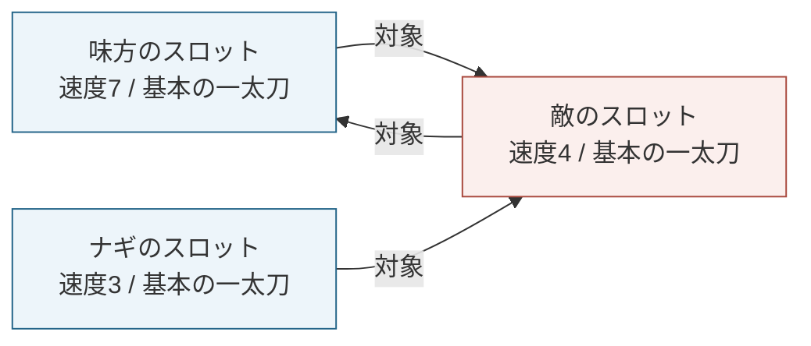
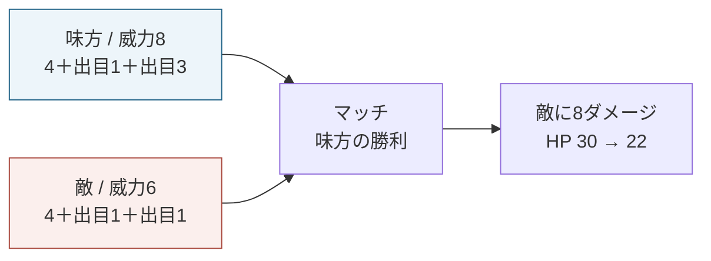
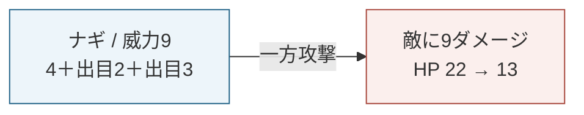

# 計画46 マッチと一方攻撃・本文と図のラフ

作成日：2026-09-18
掲載候補：基本ルール本「戦闘の流れ」の後。
状態：構成確認用。PDF化前の草案。

## 本文草案

### 同じ敵を複数人で攻撃する場合

先ほどは、ナギと敵が互いのスロットを対象にスキルを使用し、マッチが発生する例を見ました。
次は味方を1人加えて、同じ敵を2人で攻撃する場合を見ていきます。

今回は説明のために別の場面を用意します。全員が1つずつスロットを持ち、味方の行動速度は7、敵は4、ナギは3になったものとします。使用するスキルは、全員「基本の一太刀」です。状態異常や追加効果はありません。

### 1. それぞれのスロットの対象を確認する

味方と敵は互いのスロットを対象にしています。ナギも敵のスロットを対象にしますが、敵の対象は味方のスロットのままです。

図1：宣言が確定した時点の対象。矢印はスキルの対象を表しています。

この場合、味方と敵の間ではマッチが発生します。ナギに対しては敵からの指定がないため、ナギの攻撃は「一方攻撃」として処理します。今回はナギのほうが敵より遅いため、ナギの指定によって敵の対象が変わることはありません。

全員の宣言が確定したら、解決フェーズに移行します。

### 2. 味方と敵のマッチを処理する

最も速い味方のスロットから処理します。敵のスロットとマッチしているため、2人のスキルの威力を求めます。

図2：味方と敵のマッチ。この処理で、両者のスロットが処理済みになります。

今回は味方の威力が8、敵が6になったものとします。味方が勝ち、敵に8ダメージを与えます。
また、攻撃同士のマッチに勝った味方はFPを1得ます。

敵のスロットもこのマッチで処理済みになるので、敵の速度4の順番で同じ攻撃を再び行うことはありません。

### 3. ナギの一方攻撃を処理する

続いてナギのスロットを処理します。対象にしていた敵はまだ盤面に残っているため、ナギはその敵に攻撃します。

図3：ナギの一方攻撃。敵のスキルとの威力比較は行いません。

ナギの威力は9になったものとします。
今回は一方攻撃なので、その威力で敵に9ダメージを与えます。
対象の敵スロットは行動済みなのでマッチは発生しません

一方攻撃にはマッチの勝敗がないため、ナギはマッチ勝利によるFPを得ません。
ただし、「基本の一太刀」を使用しているので、ラウンド終了時にFPを2得る効果は発動します。

### この例での処理順

| 順番 | 処理 | 敵のHP |
| --- | --- | --- |
| 1 | 味方と敵のマッチ。味方が勝ち、8ダメージ | 30 → 22 |
| 2 | ナギの一方攻撃。9ダメージ | 22 → 13 |

敵のスロットに2人から攻撃が向いていても、両方とマッチするわけではありません。この例では、敵が対象にしている味方とマッチし、ナギの攻撃は一方攻撃になります。

---

## 編集用の条件・確認点（公開本文には載せない）

- 前の1ラウンドの続きではなく、比較用の別場面。ナギの速度3は速度補正2＋出目1で成立する。
- 味方は説明用の仮キャラ。速度補正2＋出目5、物理補正3とする。敵は速度補正1＋出目3、物理補正2。全員が通常の単体攻撃 `Ps-00` を使う。
- 味方と敵のHPは攻撃で倒れない条件とし、敵の開始HPは30。回避差し込み、自動防御、反撃、追加ダメージ、広域、再使用などはない。
- 味方→敵、敵→味方、ナギ→敵の相互関係が、全員の宣言確定後も成立する速度にした。ナギを敵より速くすると対象の引き寄せが関わるので、単純に同じ結果にはできない。
- 図2・3の矢印は処理結果を示す。組版では図1の「対象の矢印」と区別し、キャプションとラベルを残す。
- 本文で確認したいのは、図1の3人を追えるか、処理済みの敵にも一方攻撃が届く説明が分かるか、FPの補足をここに残すかの3点。新しいルール判断を求めるものではない。
- 全員が基本の一太刀を使うため、終了時には3人ともFP＋2。本文では一方攻撃でも終了効果が発動する点だけを説明し、開始FPからの全計算は繰り返さない。

## 実装照合と検証

- [B03 Select/Resolve仕様](../implemented/B03_SelectResolve_Spec.md) §6・§8：相互指定でマッチ、それ以外は対象スロットのキャラクターに一方攻撃。1スロットのマッチは1組。
- [redirect_flow.py](../../events/battle/redirect_flow.py)：指定側が対象より速い場合に引き寄せが発生する。速度3のナギから速度4の敵への指定では発生しない。
- [resolve_auto_single_phase.py](../../manager/battle/resolve_auto_single_phase.py)：相互指定を維持した組をマッチとし、同じ対象への第三者の攻撃は一方攻撃として扱う。マッチで処理したスロットを再処理しない。
- [既存テスト](../../tests/test_select_resolve_smoke.py)の `test_case7b_mutual_clash_is_preserved_under_third_party_contention` が第三者による指定がある場合のマッチ維持と一方攻撃を確認している。
- `test_select_resolve_smoke.py`、`test_clash_winner_fp_gain.py`、`test_skill_target_tags.py`：2026-09-18に74件成功。今回の3人・固定出目そのものをブラウザで通し再現した結果ではない。ダメージ数値は既存の基本の一太刀の式と算術で構成した。
- 調査で見つかった出典上の注意：B03 §6は複数の引き寄せ候補について「最大initiativeが最終勝者」と記載するが、現行 `redirect_flow.py` は宣言改訂番号・確定時刻で後の宣言による上書きを判断する。この草案では引き寄せ候補が競合しないため影響しない。対象変更の教材を作る前に仕様文と実装の相違を整理する。
