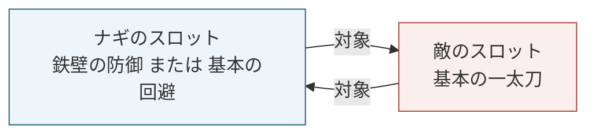

# 計画46 防御・回避を使ったマッチ・草案

作成日：2026-09-20
掲載候補：基本ルール本「マッチと一方攻撃」の後。
状態：本文と図のラフ。PDF化前。

## 本文草案

### 防御・回避を使う場合

これまでは攻撃スキルを使ったマッチを見てきました。
次は、守備スキルを使用した場合の戦闘の流れを学びましょう。

守備スキルには現在「防御スキル」と「回避スキル」の二種類があり、それぞれマッチにおける効果が異なります。

ナギが取得した「鉄壁の防御」と「基本の回避」を使う場合を例に、それぞれの効果を確かめてみましょう。

今回は敵の攻撃の威力が12になったものとして、防御と回避でそれぞれ勝った場合・負けた場合を比べます。


### 1. 敵の攻撃に防御・回避を合わせる

敵はナギのスロットを対象に「基本の一太刀」を使用します。
ナギも敵のスロットを対象に、防御か回避のスキルを選びます。



図1：ナギと敵が互いのスロットを対象にしています。

防御・回避も、攻撃と同じようにスキルの威力を求めてマッチの勝敗を決めます。
全員の宣言が確定したら、解決フェーズに移行します。

### 2. 「鉄壁の防御」で防ぐ

「鉄壁の防御」の使用コストはFP2です。ナギのFPは5から3になります。
威力は8＋1d4＋1d〈物理補正〉です。ナギの物理補正は3なので、8＋1d4＋1d3で計算します。

#### 防御が勝った場合

```text
ナギ / 鉄壁の防御                    敵 / 基本の一太刀
8＋1d4＋1d3                         4＋1d2＋1d6
8＋[3]＋[2] ＝ 13        ＞          4＋[2]＋[6] ＝ 12

ナギの防御成功：受けるダメージは0
HP 110 → 110 ／ FP 3 → 4（マッチ勝利で＋1）
```

図2：角括弧の数字がダイスの出目です。PDFでは、これまでと同じ枠付きの数字で表します。

ナギの威力が敵より高いため、防御に成功し、ダメージを受けません。
攻撃に対して防御でマッチに勝ったので、ナギはFPを1得ます。
この例では、敵にダメージを与える効果はありません。

#### 防御が負けた場合

```text
ナギ / 鉄壁の防御                    敵 / 基本の一太刀
8＋1d4＋1d3                         4＋1d2＋1d6
8＋[1]＋[1] ＝ 10        ＜          4＋[2]＋[6] ＝ 12

ナギが受けるダメージ：12－10＝2
HP 110 → 108 ／ FP 3 → 4（鉄壁の防御の敗北時効果で＋1）
```

図3：防御で負けた場合は、敵の威力から防御の威力を引いてダメージを求めます。

敵の威力12に対してナギの威力は10なので、ナギは2ダメージを受けます。
また、「鉄壁の防御」にはマッチ敗北時にFPを1得る効果があります。

### 3. 「基本の回避」で避ける

「基本の回避」には使用コストがありません。
威力は4＋1d9で求めます。

#### 回避が勝った場合

```text
ナギ / 基本の回避                    敵 / 基本の一太刀
4＋1d9                             4＋1d2＋1d6
4＋[9] ＝ 13            ＞          4＋[2]＋[6] ＝ 12

ナギの回避成功：受けるダメージは0
HP 110 → 110 ／ FP 5 → 6（マッチ勝利で＋1）
```

図4：回避の威力が敵の攻撃を上回り、ナギはダメージを受けません。

攻撃に対して回避でマッチに勝ったので、ナギはFPを1得ます。
この例では、敵にダメージを与える効果はありません。

回避に成功すると、条件を満たす後続の攻撃に対して「再回避」ができる状態にもなります。
今回はこのマッチまでを扱い、再回避の条件と処理は別の例で説明します。

#### 回避が負けた場合

```text
ナギ / 基本の回避                    敵 / 基本の一太刀
4＋1d9                             4＋1d2＋1d6
4＋[3] ＝ 7             ＜          4＋[2]＋[6] ＝ 12

ナギが受けるダメージ：12
HP 110 → 98 ／ FP 5のまま
```

図5：回避で負けた場合は、敵の威力ぶんのダメージを受けます。

ナギは12ダメージを受けます。
防御のように、敵の威力から自分の威力を引くことはできません。

### スキルの種類とマッチの勝敗

| 使用スキル | マッチの結果 | 受けるダメージ |
| --- | --- | --- |
| 鉄壁の防御 | 勝利（13対12） | 0 |
| 鉄壁の防御 | 敗北（10対12） | 2 |
| 基本の回避 | 勝利（13対12） | 0 |
| 基本の回避 | 敗北（7対12） | 12 |

防御は負けた場合も、防御の威力ぶんだけダメージを減らせます。
回避は勝てばダメージを受けませんが、負けた場合は敵の威力ぶんのダメージを受けます。

防御・回避のスキルにも、スキルごとにさまざまな効果があります。使うときは、スキルの効果も確かめてみてください。

---

## 編集・検証メモ（公開本文には載せない）

- ユーザーが修正した前章に合わせ、段落内でも説明の区切りで改行した。PDF化時はこの区切りを保持し、図と直後の説明を同じページに配置する。
- 図2〜5は「スキル名／威力式／枠付き出目／結果」を共通形式で組版する。図ラフの角括弧は枠の代用。「出目1」の表記へ戻さない。
- 敵は今回の教材用に物理補正6とする。前章の敵と同一データとは扱わない。基本の一太刀の4＋1d2＋1d6で、出目2・6なら12。ナギの鉄壁の防御は最低10なので、防御敗北も説明できる値を選んだ。
- HP110・MP9・FP5はラウンド開始時の処理を済ませた、スキル使用直前の値。ラティウムの開始時判定は繰り返さない。全例でMPは変化しない。
- 互いに1スロット、対象確定済み。追加補正、状態異常、反撃、自動防御、再使用、他の攻撃はなし。ナギの出身はラティウムであり、防御勝利時に反撃する出身ボーナスはない。
- 2026-10-17ユーザー確認：表は「スキルの種類とマッチの勝敗」とし、使用スキル・マッチの結果・受けるダメージだけを載せる（処理後のHP・FPは載せない）。FPの増減の補足文と、使用時の消費という表現は削除し「使用コスト」に統一。
- 結果表はマッチ直後。敵が使用した基本の一太刀のラウンド終了時FP＋2はこの表の範囲外。防御・回避に攻撃側が勝っても、攻撃側にマッチ勝利FPは付かない。
- 同値と再回避の具体例は次の補足候補。同値の扱いをこの4例から推測させない。今回の表は厳密に大小が付く場合だけを扱う。

### 出典と確認範囲

- [スキルキャッシュ](../../data/cache/skills_cache.json)：`D-02` は威力8＋1d4＋1d〈物理補正〉、FP2消費、LOSE時FP＋1。`D-01` は4＋1d9、使用コスト・固有効果なし。
- [duel_solver.py](../../manager/battle/duel_solver.py)：防御敗北の差分ダメージ、回避敗北の全威力ダメージ、成功時の無傷・FP獲得・再回避状態を照合。
- [B03仕様](../implemented/B03_SelectResolve_Spec.md) §8.5・§9：防御／回避側が攻撃に勝った場合のFP獲得、再回避の条件。
- 実データを `_compute_match_damage_from_rolls` に渡し、防御12対10で2、回避12対7で12を確認。`_should_grant_clash_win_fp` で勝利FPの対象側を確認。`process_skill_effects` で鉄壁の防御のLOSE時FP＋1を確認。
- 関連既存テスト：`test_skill_target_tags.py`、`test_clash_winner_fp_gain.py`、`test_resolve_effect_cost.py`。2026-09-20に30件成功。固定出目の4例をブラウザで通し再現したものではない。
