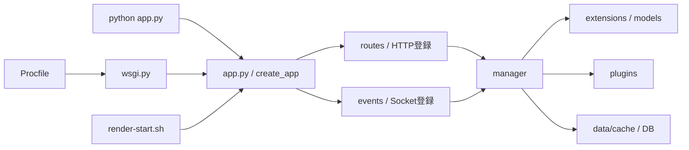

# ファイル・参照関係の初回棚卸し

調査日: 2026-10-31
課題: `REPO-INVENTORY`。方針は[構成整理計画](repository_structure.md)、進捗と次の作業は[課題一覧](backlog.md)を参照。

整理後の注記（2026-10-31）：本書の件数・配置は初回調査時点の記録。後続の `REPO-DOCS` で[ルートREADME](../../../README.md)を作成し、`readme.txt`・`RENDER_SETUP.md`・`task.md`をREADME・F01・E01へ統合して削除した。以下の旧ファイル名と整理候補は調査時の記録として残す。現状と結果は[課題一覧](backlog.md)を参照する。

同日の `REPO-DRAFTS` で、未使用草稿 `manager/temp_logic_draft.py`・`temp_animation.css`・`static/css/modules/temp_skill_grid.css`・`CharaCreator/_tmp_builder_check.js` を現行実装と比較して削除した。[実施結果](backlog.md#repo-drafts実施結果)に保持先と検証を記録している。

同日の `REPO-OUTPUTS` では、順次効果の検証を `tests/test_sequential_effects.py` に集約し、出力を作る重複テスト `tests/test_seq_simple.py` と `test_results.txt` を削除した。履歴PDF・移行記録・旧ログの27本は、ユーザー選択1によりすべて現在の場所とGit管理のまま保持する方針となり、変更していない。

同日の `REPO-BOUNDARIES` では、カタログ検証を `manager/skill_catalog_validation.py`、戦闘専用の構築処理を `manager/battle_only_runtime.py`へ集約した。以下の `manager→scripts`・`sim→events` は初回調査時の経路で、現行では解消している。[実施結果](backlog.md#repo-boundaries実施結果)を参照する。

同日の `REPO-ENTRYPOINT` では、ユーザー提示のRender設定画面で `render-start.sh` の利用を確認した。本番の `app:app` にProcfileを統一し、未使用のルート `wsgi.py` を削除した。以下の入口不一致と未確認の記載は初回調査時点の記録であり、現在の設定は[F01 §8](../../implemented/F01_Operations_Manual.md#8-起動と接続設定)、検証結果は[課題一覧](backlog.md#repo-entrypoint実施結果)を参照する。

同日の `REPO-CACHE-PATHS` では、8 JSONの現行配置を確認し、ルート旧配置へのフォールバック・自動コピーを削除した。JSON自体の内容・配置・Git管理は変更していない。以下の旧パス読込は初回調査時点の記録。旧保存データ4本の保管方法は[判断事項](backlog.md#repo-legacy-data判断事項)として分けて扱う。

同日の `REPO-LEGACY-DATA` はユーザー選択1に基づき、旧ルートJSON2本とDB1本を `_local/legacy_data/2026-10-31/`、旧画像JSONを `data/archive/images.json` へ原本のまま退避した。以下の旧保存データの位置・保持未確認という記述は初回調査時点の記録。現在の保管先と検証は[決定・結果](backlog.md#repo-legacy-data判断事項)を参照する。

## 1. 調査範囲と結論

Gitの追跡パス、ルートと主要ディレクトリの用途、起動・HTTP・Socketの入口、Python import、JS/CSSのビルド、データ読込、生成物と資料の参照を確認した。対象コードをimportせずに調べており、アプリ起動・DB操作・Google Sheets更新・ビルド・ファイル移動・削除は行っていない。

本体、資料、制作物、テストの大きな区分はすでに存在する。まず入口資料と起動方法の整理、参照の見つからない草稿の確認、出力の保存方針の整理から始めると、広いパス変更を避けながら所在を追いやすくできる。一方、`manager/` と `scripts/`・`events/`、出版物と本体には実際の依存があるため、フォルダ名だけで切り離すことはできない。

「参照未検出」は削除可能の判定ではない。動的参照、外部設定、手動利用、唯一の成果物の有無は、各候補の実施前に再確認する。

### 集計の基準

- 基準HEADは `aec9150`。既存の文書変更と未追跡の常設プロジェクト文書がある作業ツリーを調査した。
- `git ls-files -z` の追跡パスは860件。列挙されたパスの作業ツリー上の合計は37,302,369 bytes（約35.6 MiB）。Git履歴やローカル環境を含むディスク使用量ではない。
- 集計時の未追跡ファイルは、この常設プロジェクトの文書5件。本棚卸し文書はその後に追加したため、下表には含まれない。
- 追跡Python 395本をASTで解析し、構文解析失敗は0件。import文の静的な調査であり、実行成功や全依存の網羅を保証しない。
- `.env`・認証JSON・DB・監査ログ本文は読み取らず、必要な存在・追跡状態・サイズと、ソース上の読込先を確認した。

## 2. フォルダ単位の分類

件数は追跡ファイル数。役割は現在のコード・生成元・資料の確認に基づく。

| 区分 | 件数 | 用途と主な参照 | 保持・整理の方向 |
|---|---:|---|---|
| ルート直下 | 29 | 起動、共有状態、モデル、設定、規約に、旧説明・記録・出力が同居 | 次節で分類。入口と過去記録を優先整理 |
| `.github/` | 1 | Python依存導入、文字検査、スキルsmoke・strictテスト、lintのCI | 維持。スクリプト再配置時に更新 |
| `events/` | 26 | Socket入口。直下9、戦闘10、戦闘専用7 | イベント登録と下位の処理を分けて確認 |
| `routes/` | 6 | account、room、admin、owned_charactersのBlueprintと共通部品 | `app.py`の登録先。既存の分割を活かす |
| `manager/` | 110 | ロジック・状態・保存・外部データ・シミュレーション。直下38、battle50、その他22 | 責務ごとの整理候補。import先を同時に変更する必要あり |
| `plugins/` | 24 | カスタム効果6、buff13、item5 | 実行時に利用。バフの動的探索もある |
| `static/` | 124 | PC UI、画像・音、バンドル、停止中モバイル | ソース・成果物・素材を区別して保持 |
| `CharaCreator/` | 4 | キャラ作成HTML、JSON定義ビルダーHTML・参照JS、検証用に見えるJS | キャラ作成はHTTP配信あり。ビルダー系は別途利用確認 |
| `data/` | 13 | cache9（8 JSONと`.gitkeep`）、制約検証JSON3、`images.json` | マスターを一時キャッシュ扱いにしない。画像JSONは用途未確定 |
| `scripts/` | 36 | 直下のPython17とビルドJS1、漢字データ1、演出一覧8、解決プレビュー9 | 本体から呼ぶものと開発専用のものを区別 |
| `tests/` | 207 | Python203、E2E等。`legacy/`にも現行ロジックのテストあり | 名前だけで除外しない。パス変更時はfixture・ソース参照も更新 |
| `manuals/` | 63 | 直下5、実装15、運用1、計画27、テスト案内9、Typst整形版6 | 新しい常設文書は未追跡のため集計外。正本と入口を維持 |
| `typst_manual/` | 191 | 共通8、assets1、基本本22、操作ガイド15、試作14、動画131 | 本体の配信・素材・制作検査との接点を保持 |
| `output/` | 22 | すべて `output/pdf/46_*.pdf`。書籍の章別レビュー・比較PDF | 制作資料からの参照と保持指定あり。一括削除の対象にしない |
| `logs/` | 4 | すべて `migration_v2/` の過去JSON・報告 | 現行監査ログとは別。過去記録の保持判断が必要 |

`scripts/`のPython合計18本には、`fx_gallery/embed_icons.py`を含む。直下はPython17本とビルドJS1本の18件。

## 3. ルート直下29ファイル

| ファイル | 現在の役割・参照 | 整理案・保持条件 |
|---|---|---|
| `app.py` | アプリfactory、HTTP登録、既定app、ローカル起動、マスター更新 | 起動の中核として維持。将来の分割は起動副作用・設定・配信パスと一緒に扱う |
| `wsgi.py` | 既定app作成を抑制してfactoryを呼ぶ。`Procfile`が `wsgi:app` を指定 | 起動入口の統一検討まで保持 |
| `extensions.py`・`models.py` | DB・SocketIO・共有辞書とモデル。多数の本体・テストからimport | 単独移動を後回しにし、状態の所有者とimportをまとめて設計 |
| `Procfile`・`gunicorn_config.py`・`render-start.sh` | Gunicorn入口とワーカー設定。入口の指定に差がある | 次節の不一致を調査。本番設定確認後に整理 |
| `render-build.sh`・`runtime.txt` | Python依存導入とPython 3.11.5指定 | Render側設定の利用実態を確認して保持 |
| `requirements.txt`・`requirements-dev.txt` | 本番依存の固定と開発依存。Render・CI・依存整合テストから参照 | ルート維持が自然 |
| `package.json`・`package-lock.json` | esbuild依存、build/gallery/resolve-previewコマンド | ビルド入口として維持 |
| `pytest.ini` | `testpaths = tests`、警告・E2Eマーカー設定 | テスト入口として維持 |
| `.editorconfig`・`.gitattributes`・`.gitignore`・`.pre-commit-config.yaml` | 書式、追跡除外、文字検査 | Gitとツールの標準配置として維持 |
| `AGENTS.md`・`CLAUDE.md`・`CONTRIBUTING.md` | 共通規約、Claudeからの規約参照、文字コード方針 | 導線を保って維持 |
| `readme.txt` | 起動と更新の2コマンドだけを記した入口 | 将来のルートREADMEへ統合する候補 |
| `RENDER_SETUP.md` | 過去の障害対応と設定説明。`app:app`記載、接続プール説明の重複あり | F01と運用手順へ必要な事実を照合・統合する候補 |
| `task.md` | すべてチェック済みの過去の自由移動・デザイン改修記録 | E01/E02との照合後に統合・削除を判断 |
| `temp_animation.css` | `floatUp`の短い草稿。ビルド・HTML参照は未検出 | 本番CSS・演出テストとの比較後に削除候補 |
| `error.log` | 2,258 bytesの追跡ログ。現行loggerは標準出力を使う。書込元未検出 | 再生成元・保持目的の確認後に追跡方針を整理 |
| `test_results.txt` | 845 bytes。`tests/test_seq_simple.py::test_sequential` がカレントディレクトリへ書く | 出力先とテストを直してから追跡出力を整理。消すだけでは再生成する |
| `gemlia_trpg_manual_20251220.pdf` | 基本本READMEが旧配布資料として明示的に保持 | 履歴資料として保持。移すなら参照も更新 |
| `ジェムリアTRPGダイスボット.url` | ローカルで使うショートカット。コードからの参照は未確認 | 利用者の入口として保持。アプリ本体との関係を確認して配置判断 |

## 4. 起動・状態・参照の経路



この図は主要経路であり、厳密な一方向のレイヤー構成ではない。以下の逆向き・横断依存も確認した。

| 経路 | 根拠 | 再配置時の注意 |
|---|---|---|
| 起動方法の差 | [Procfile](../../../Procfile)は `wsgi:app`、[render-start.sh](../../../render-start.sh)と旧設定説明は `app:app`。旧説明の現行情報は[F01 Part 3](../../implemented/F01_Operations_Manual.md#part-3-renderデプロイ運用手順)へ統合 | どちらもコードとして入口が存在する。本番のStart Commandは未確認なので、即座に起動不良とは判定しない |
| app→Socket登録 | [register_socket_handlers](../../../app.py)が9モジュールを明示import。[events/battle](../../../events/battle/__init__.py)が4ルート群をimport | ファイル移動だけでなく登録時の副作用と依存順を検証 |
| app→HTTP登録 | [register_http_routes](../../../app.py)が4 Blueprintと個別ルートを登録 | `/chara_creator`、`/manuals/<name>`、静的配信の相対ルートを保つ |
| manager→scripts | [data_manager.py](../../../manager/data_manager.py)がマスター取得成功後に `scripts.skill_catalog_tool` のlint関数をimport | `scripts/`全体を開発専用として配布から外さない。lintの共通ロジックを本体側へ寄せる候補 |
| manager/sim→events | [preset_loader.py](../../../manager/sim/preset_loader.py)が `events.battle_only.runtime_builders` の3関数をimport | シミュレータとSocketが共有する構築処理の所在を見直す候補 |
| manager→app | `data_manager.py`の手動実行と `manager/sim/preset_loader.py` のDB読込分岐からfactoryを参照 | import全件を通常実行時の循環と断定しない。条件と初期化フラグを保持 |
| manager↔plugins | `manager/game_logic.py`等からレジストリを使用し、プラグインもmanagerの状態・補助処理を利用 | `__init__.py`での公開関数と遅延importを確認 |
| 動的なバフ探索 | [BuffRegistry.auto_discover](../../../plugins/buffs/registry.py)が隣接Pythonを列挙し `plugins.buffs.<name>` をimport | 静的importの被参照数0だけでプラグインを消さない |
| アイテム・効果登録 | [plugins/items/__init__.py](../../../plugins/items/__init__.py)、[plugins/__init__.py](../../../plugins/__init__.py)は明示レジストリ | バフと同じ探索方式ではない。登録表とIDの利用を確認 |
| 制作ツール→app | [動画用ローカルWSGI](../../../typst_manual/動画/scripts/s1-local-wsgi.py)がルート位置を計算して `app` をimport | 動画を本体から分離する場合は制作検査の起動・相対パスも変更 |

AST解析対象の内訳はルート5、events26、manager110、plugins24、routes6、scripts18、tests203、動画3。絶対importだけでも、events→manager、routes→manager、manager→extensions/models/plugins、およびテストからの多数の参照がある。相対import、`sys.modules`による差し替え、動的探索は別途ソースで確認した範囲を上表に補った。

## 5. フロントエンドの編集元と生成先

| 編集元・生成元 | 利用先・出力 | 判定 |
|---|---|---|
| [build_frontend.mjs](../../../scripts/build_frontend.mjs) の `CLASSIC_SCRIPTS` 43本 | `static/dist/app.bundle.js`とmap | 順序が契約。グローバル共有のため単純なESモジュール化は別設計 |
| [battle/index.js](../../../static/js/battle/index.js) からたどる23本 | `static/dist/battle.bundle.js`とmap | importの `?v=` はビルド時に除去して解決 |
| [styles.css](../../../static/styles.css) の17 import | `static/dist/app.bundle.css`とmap | CSSソース18本のうち、下記1本だけ通常のimport対象外 |
| [static/index.html](../../../static/index.html) | 上記3バンドルとSocket.IOの外部CDNを読込 | 個別ソースは直接追加しない。ハッシュはビルドが更新 |
| `static/css/modules/temp_skill_grid.css` | ファイル名の参照、styles.cssからの読込を未検出 | 現行UIの同名セレクタとの比較が必要な整理候補 |
| `CharaCreator/GEMDICEBOT_CharaCreator.html` | appの `/chara_creator` から配信 | インラインJS主体の独立HTML。通常バンドルの対象外でも使用中 |
| `CharaCreator/json_definition_builder.html` | 隣接する `json_builder_reference_data.js` を参照 | メインUIバンドルの外にある制作ツール。公開・手動利用の確認を残す |
| `CharaCreator/_tmp_builder_check.js` | HTML・ビルド・テストからのファイル名参照を未検出 | ビルダーの現行インラインJSと完全一致しない。唯一の変更がないか比較してから判断 |
| `scripts/fx_gallery/`・`scripts/resolve_preview/` | `npm run gallery` / `resolve-preview` で `_local/` 内のHTMLを生成 | 検査用ツールとして保持。staticのソース・画像も読んで埋め込む |
| `static/mobile/` 10本 | 開発停止、HTTP配信停止の対象 | 今回は所在のみ分類。変更・削除は別途ユーザーへ確認する |

追跡されている `static/js/` の66本は、上記43＋23本ですべて到達できた。ビルド入力と相対import先の存在も確認した。未使用JavaScriptが大量に残っているという根拠は、この範囲では見つからなかった。

`static/dist/`の6成果物はRenderにNodeがないため保持する。背景画像などの大きい素材も、ファイル容量だけで削除しない。転送・解像度の最適化は `PERF-ASSETS` の実測で扱う。

## 6. データ・資料・生成物の境界

| 対象 | 読込・生成元 | 保持と未確認点 |
|---|---|---|
| `data/cache/` の8 JSON | [cache_paths.py](../../../manager/cache_paths.py)と各loader。Google Sheets等の取得・保存経路あり | 起動とマスター参照に使用。削除で外部取得や空データ化を招く可能性がある |
| 旧ルートマスターのフォールバック | `cache_paths.load_json_cache`が旧パスを読み、新パスへ保存するコードを保持 | 現在の配置整理とは別に、後方互換不要の方針と照合する候補 |
| ルーム・アカウント・画像登録情報 | `models.py`、`data_manager.py`、`image_manager.py`、`log_archive.py`がDB利用 | 正本はメモリ／DBの現行契約に従う。ルートの古いJSONとは区別 |
| `data/images.json` | ファイル名・パスの直接参照を追跡ソースから未検出。デフォルト画像登録は `static/images/characters` とDBを利用 | 現行生成元と手動利用は未特定。保持したまま要確認 |
| 基本本・操作ガイドの `main.typ` → `main.pdf` | [build_publications.py](../../../scripts/build_publications.py)とTypst。`app.py`の `/manuals/<name>` がPDFを配信 | ソース・PDFの両方を保持。`output/release/`は配布名を付けたローカルコピー |
| `typst_manual/全体マニュアル/旧版/` とルート旧PDF | 各冊子READMEの履歴参照 | 明示的な保持対象。履歴の所在を変えるならリンクも更新 |
| `output/pdf/46_*.pdf` 22本 | 各冊子・試作のREADMEとTypst冒頭に生成コマンド。4種の紙面比較は `build_publication_comparison.py` | [出版物管理方針](../../../typst_manual/README.md)がGit管理を指定。使い捨て出力との境界を見直す際はこの方針も更新 |
| `46_operation_guide.pdf` と操作ガイド `main.pdf` | 同じ1,762,914 bytesだがSHA-256は不一致 | 同サイズだけで重複削除しない。内容の同一性・必要性は未判定 |
| `manuals/typst/` | Markdown正本の整形版。`build/`のPDFはGit除外 | `typst_manual/`のルール本とは役割が異なる。名前だけで統合しない |
| `typst_manual/動画/` | 制作用ソース・共通素材・検査スクリプト。outや音声キャッシュは除外対象 | ローカル素材・声キャッシュなど再制作に必要なものを保持 |
| `logs/migration_v2/` 4本 | `scripts/migrate_skill_json_rule_v2.py` の出力先 | 元データの写し3本と報告1本。再生成の要否・保持目的を決めてから整理 |

## 7. ローカル専用物と除外の範囲

| 対象 | 追跡・除外の確認 | 扱い |
|---|---|---|
| `.env`・認証JSON | `.gitignore`で除外、追跡なし | 設定・秘密情報として保持。本文は未読 |
| `.venv/`・`node_modules/`・`__pycache__/` | `.gitignore`で除外 | 環境・依存・キャッシュ。内容を全量走査していない |
| `instance/` | ディレクトリ全体を除外。DBとWAL/SHM、検証名のDBが存在 | 実データと実行状態を確認してから扱う。WAL/SHMの存在だけで使用中とは断定しない |
| `saved_rooms.json`・`battle_state.json`・`users.db` | ルートの旧データとして除外。現行Python/JSからファイル名参照を未検出 | 内容・復元要否は未確認。自動削除しない |
| `logs/json_rule_v2_audit.jsonl` と `.1` | 除外済み。約2.50 MBと232.94 MB（10進表記） | 現行コードは20 MiB超で1世代ローテーションし、成功の詳細記録は既定オフ。大きい旧世代の由来・保持要否は未確認 |
| `_local/` | 除外済み。fx_gallery、resolve_preview、resolve_stage_checkの3置き場 | 別セッションの確認結果を含む可能性。作成者が区切りで整理 |
| `output/release/`・`tmp/pdfs/` | それぞれルート`.gitignore`で除外 | 配布コピーとPDF確認用出力。正本とは分けて扱う |
| `typst_manual/_local/`・動画のout/音声キャッシュ等 | 個別ルールで除外 | 必須フォント・素材・再利用音声は保持。全容量の調査は未実施 |
| `.pytest_cache/` | 自身の`.gitignore`が子を除外 | ルートへの `check-ignore` 結果だけでは判定できない例 |
| `.tmp_sim/` | `.git/info/exclude`だけで除外 | この作業環境専用の設定。他環境で同じ除外になるとは限らない |
| `.agents/`・`.vscode/`・`locks/`等 | 追跡0。今回の直下確認では空。草稿用フォルダ・`.pnpm-store/`も追跡0 | 空フォルダや子の除外と、親ディレクトリ全体の除外を区別。環境ごとの使用は未確認 |

監査ログのサイズは現在の待ち時間の原因を示すものではない。保持・ローテーション方針と観測負荷は `OPS-OBSERVE` で確認する。

## 8. 次の整理候補と実施条件

すべて提案。今回の棚卸しで移動・削除・構成変更を実施決定したものではない。

| 優先順 | 候補と配置案 | 実施前の確認・検証 | 担当課題 |
|---|---|---|---|
| 1 | ルートREADMEを整備し、readme.txt・RENDER_SETUP・taskの現行情報をF01/E01/E02へ寄せる | 現行コードと正本へ照合。古い手順をコピーせず、統合後のリンクを検査 | REPO-DOCS |
| 2 | `Procfile`・`wsgi.py`・起動スクリプトの入口と説明をそろえる | Renderの実Start Commandを確認。factory、Socket登録、初期化・終了時保存をテスト | REPO-ENTRYPOINT |
| 3 | `temp_animation.css`・`temp_skill_grid.css`・`temp_logic_draft.py`・`_tmp_builder_check.js`を整理 | 草稿の固有内容と現行実装を比較。外部・手動利用確認。CSS変更扱いならビルド、Pythonは関連テスト | REPO-DRAFTS |
| 4 | `test_results.txt`等の追跡出力と生成先を整理 | テストの書込先をtmp_path等へ変更し、再生成しないことと保持要否を確認 | REPO-OUTPUTS |
| 5 | `output/pdf/`・旧PDF・migration記録の保持規約と候補配置を決める | 書籍制作の保持指定・参照を照合。正本・履歴資料を保全してから再配置 | REPO-OUTPUTS |
| 6 | `data/images.json`・旧ルートデータ・旧パス読込の扱いを確定 | 生成元、手動利用、復元要否を確認。実データと互換コードを分けて判断 | REPO-LAYOUT |
| 7 | lint共通処理とプリセット構築処理を利用側から独立させる | `manager→scripts`と`sim→events`の呼出し・公開関数・テストを調査。配置案は未決定 | REPO-BOUNDARIES |

初回の実施候補は1の「入口資料の整理」。その後、確認範囲の狭い草稿・出力から進め、本体を一括で `src/` へ移すような変更は現段階では選ばない。

## 9. 調査方法・残る確認

再調査では `git ls-files -z` の結果をUTF-8で読み、パス別に集計する。日本語パスをコンソールへ出す場合は出力の文字コードもUTF-8にそろえる。

```powershell
git status --short
git ls-files
git ls-files --others --exclude-standard
git check-ignore -v -- <確認するパス>
git -c core.quotepath=false grep -n -I -F -e <ファイル名や識別子> -- <対象範囲>
```

Pythonは追跡 `.py` のASTからImport/ImportFromを読み、ローカルパッケージ間の経路を確認した。JSはCLASSIC_SCRIPTSの入力と、battle/index.jsから相対importを再帰的にたどり、CSSはstyles.cssのimportと追跡CSSを照合した。PDFの比較はバイト列のハッシュのみで、内容・見た目の比較は行っていない。

残る確認は、本番の実起動設定、参照未検出ファイルの手動・外部利用、旧データ・ログ・制作物の保持理由、無視対象ディレクトリの全容量と現在の利用者、将来移動するモジュールごとの完全な呼出し・保存・テスト契約。これらは削除や本体再配置の実施条件として残す。

棚卸し結果の検証は、ソースと登録表・生成コマンドの照合、静的な入力パスの存在、文書のリンク・文字コード・差分検査で行う。アプリの動作変更はないため、実行テスト・ビルドは実施対象としない。
